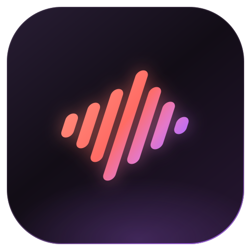
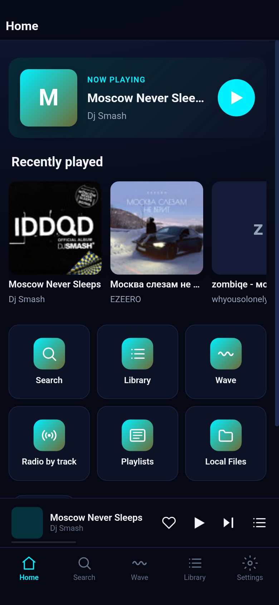
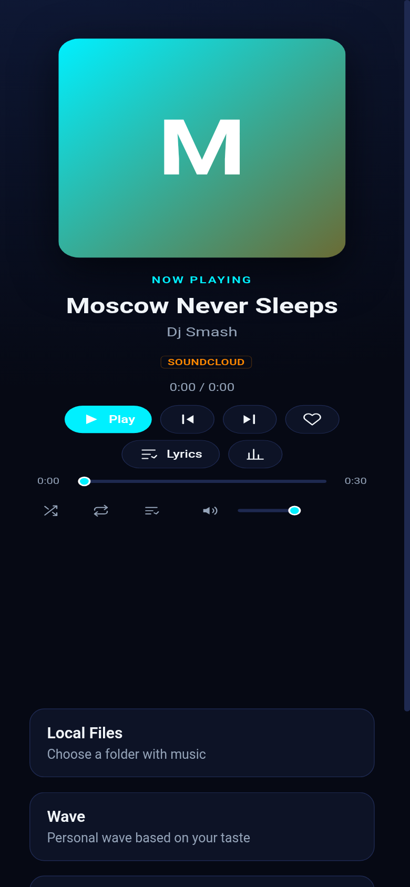
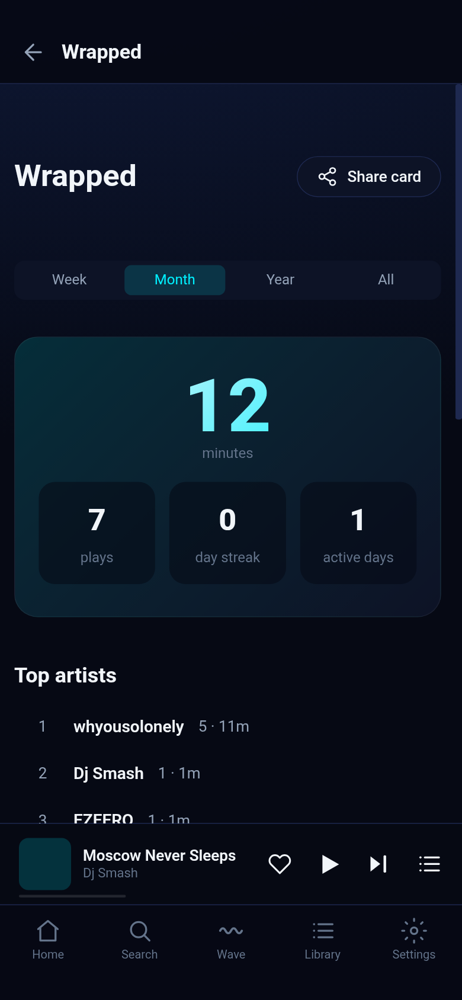

<p align="center">
  <a href="https://milalulu.github.io/wave/">
    
  </a>
</p>

<h1 align="center">
  <picture>
    <source media="(prefers-color-scheme: dark)" srcset="https://raw.githubusercontent.com/milalulu/wave/master/public/title.svg" />
    
  </picture>
</h1>

<p align="center">
  <em>Музыкальный плеер, который слушает тебя</em>
</p>

<p align="center">
  <a href="https://github.com/milalulu/wave/releases/latest"></a>
  <a href="https://github.com/milalulu/wave/blob/master/LICENSE"></a>
  <a href="https://github.com/milalulu/wave/actions/workflows/ci.yml"></a>
  
</p>

---

<p align="center">
<svg width="600" height="80" viewBox="0 0 600 80" xmlns="http://www.w3.org/2000/svg">
  <defs>
    <linearGradient id="waveGrad" x1="0%" y1="0%" x2="100%" y2="0%">
      <stop offset="0%" stop-color="#00e5ff" stop-opacity="0">
        <animate attributeName="stop-opacity" values="0;1;0" dur="3s" repeatCount="indefinite" />
      </stop>
      <stop offset="50%" stop-color="#00e5ff" stop-opacity="1" />
      <stop offset="100%" stop-color="#7c5cff" stop-opacity="0">
        <animate attributeName="stop-opacity" values="0;1;0" dur="3s" repeatCount="indefinite" />
      </stop>
    </linearGradient>
  </defs>
  <path fill="none" stroke="url(#waveGrad)" stroke-width="2.5" stroke-linecap="round">
    <animate attributeName="d"
      values="M0,40 C30,40 50,10 80,10 C110,10 130,70 160,70 C190,70 210,10 240,10 C270,10 290,70 320,70 C350,70 370,10 400,10 C430,10 450,70 480,70 C510,70 530,10 560,10 C590,10 600,40 600,40;
              M0,40 C30,40 50,70 80,70 C110,70 130,10 160,10 C190,10 210,70 240,70 C270,70 290,10 320,10 C350,10 370,70 400,70 C430,70 450,10 480,10 C510,10 530,70 560,70 C590,70 600,40 600,40;
              M0,40 C30,40 50,10 80,10 C110,10 130,70 160,70 C190,70 210,10 240,10 C270,10 290,70 320,70 C350,70 370,10 400,10 C430,10 450,70 480,70 C510,70 530,10 560,10 C590,10 600,40 600,40"
      dur="4s" repeatCount="indefinite" />
  </path>
  <path fill="none" stroke="url(#waveGrad)" stroke-width="1.5" stroke-linecap="round" opacity="0.4">
    <animate attributeName="d"
      values="M0,40 C40,40 60,15 90,15 C120,15 140,65 170,65 C200,65 220,15 250,15 C280,15 300,65 330,65 C360,65 380,15 410,15 C440,15 460,65 490,65 C520,65 540,15 570,15 C600,15 600,40 600,40;
              M0,40 C40,40 60,65 90,65 C120,65 140,15 170,15 C200,15 220,65 250,65 C280,65 300,15 330,15 C360,15 380,65 410,65 C440,65 460,15 490,15 C520,15 540,65 570,65 C600,65 600,40 600,40;
              M0,40 C40,40 60,15 90,15 C120,15 140,65 170,65 C200,65 220,15 250,15 C280,65 300,65 330,65 C360,65 380,15 410,15 C440,15 460,65 490,65 C520,65 540,15 570,15 C600,15 600,40 600,40"
      dur="4s" repeatCount="indefinite" />
  </path>
</svg>
</p>

<p align="center">
  
  
  
  <br />
  <sub>Реальные скриншоты с Android — home, плеер, Итоги</sub>
</p>

---

## Скачать

<table align="center">
<tr>
  <td align="center"><b>Windows</b></td>
  <td align="center"><b>Linux</b></td>
  <td align="center"><b>Android</b></td>
</tr>
<tr>
  <td align="center">

[`.msi`](https://github.com/milalulu/wave/releases/latest/download/Wave_0.6.0_x64_en-US.msi)
&middot;
[`.exe`](https://github.com/milalulu/wave/releases/latest/download/Wave_0.6.0_x64-setup.exe)

  </td>
  <td align="center">

[`.deb`](https://github.com/milalulu/wave/releases/latest/download/Wave_0.6.0_amd64.deb)
&middot;
[`.rpm`](https://github.com/milalulu/wave/releases/latest/download/Wave-0.6.0-1.x86_64.rpm)
&middot;
[AppImage](https://github.com/milalulu/wave/releases/latest/download/Wave_0.6.0_amd64.AppImage)

  </td>
  <td align="center">

[APK (universal)](https://github.com/milalulu/wave/releases/latest/download/wave-android.apk)

  </td>
</tr>
</table>

<p align="center"><sub>Автообновления встроены (Tauri updater). <a href="https://github.com/milalulu/wave/releases">Все релизы &rarr;</a></sub></p>

---

## Что нового в 0.6.0

- **Импорт по ссылке** — Spotify / YouTube-видео / SoundCloud трек и сет → плейлист в один клик
- **Итоги (Wrapped)** — минуты, стрики, топы + шаринг-карточка PNG
- **Виджет** на homescreen и **Android Auto** с медиасессией
- **Будильник** с нарастающей громкостью, **голосовой поиск**, **шеринг треков**
- **Экономия трафика** (качество Wi-Fi/мобильные отдельно), **авто-офлайн**, автодополнение поиска
- Папки плейлистов, продолжение на другом устройстве, цветные плейсхолдеры

[Полный чейнджлог &rarr;](https://github.com/milalulu/wave/blob/master/CHANGELOG.md)

---

## Что это

**Wave** — музыкальный плеер, который агрегирует источники в один интерфейс: нативный поиск и стрим **SoundCloud** (api-v2) и **YouTube Music** (innertube) без yt-dlp на Android, плюс iTunes, Deezer, Spotify, Last.fm, MusicBrainz, VK и локальные файлы. Умное радио продолжает очередь реальными related/automix-треками, а «Моя волна» миксует по твоим вкусам.

**Стек:** Tauri 2 (Rust) &middot; React 19 &middot; TypeScript &middot; Zustand &middot; SQLite &middot; axum HTTP API

---

## Возможности

<details open>
<summary><b>Поиск и источники</b></summary>
<br>

| Источник | Поиск | Воспроизведение | Примечание |
|---|:---:|:---:|---|
| YouTube Music | :white_check_mark: | :white_check_mark: полные треки | нативный innertube (без yt-dlp), стримы с авто-перерезолвом |
| SoundCloud | :white_check_mark: | :white_check_mark: прямой mp3 | нативный api-v2 через Rust, без yt-dlp |
| Spotify | :white_check_mark: | :white_check_mark: превью / YT-фолбэк | выживший после чисток API 2024–2026 |
| iTunes / Deezer | :white_check_mark: | :white_check_mark: превью 30с | официальные API |
| Last.fm / MusicBrainz | :white_check_mark: | :x: метаданные | скробблинг, теги, похожее |
| Локальные файлы | :white_check_mark: | :white_check_mark: полные файлы | ID3/FLAC/MP4 через lofty |

Локальное автодополнение (лайки + история + недавнее), голосовой поиск, импорт плейлистов по ссылке и из M3U/JSON.

</details>

<details open>
<summary><b>Плеер и звук</b></summary>
<br>

- Очередь с drag-and-drop, **Play Next**, shuffle / repeat, сон-таймер, будильник
- Настоящий **gapless** в буферном режиме, кроссфейд, **автогейн громкости**
- Эквалайзер (10 полос + пресеты), bass boost, reverb, скорость
- Горячие клавиши, медиаклавиши, MPRIS, мини-плеер, трей
- Авто-фолбэк на другой источник, апгрейд превью до полной версии, **сохраняемый выбор источника** для одной записи без потери лайка и места в плейлисте

</details>

<details open>
<summary><b>Волна и радио</b></summary>
<br>

- **Радио-продолжение**: SoundCloud related + YouTube automix up-next в конце очереди
- **Моя волна**: микс по лайкам/истории/жанрам + межпровайдерное ранжирование кандидатов
- Радио по треку, топ артиста, блокировки треков и артистов, Итоги года

</details>

<details open>
<summary><b>Библиотека и офлайн</b></summary>
<br>

- Плейлисты: папки, свои обложки, M3U/JSON импорт-экспорт, шаринг, умные плейлисты
- Загрузки с докачкой (сетевые треки резолвятся без yt-dlp), авто-офлайн при обрыве сети
- Лайки / история / статистика в SQLite, бэкап БД
- Тексты песен (синхронизированный LRC), редактор тегов локальных файлов

</details>

<details open>
<summary><b>Android</b></summary>
<br>

- Виджет homescreen, Android Auto (медиасессия), нотификация с управлением
- Экономия трафика: качество отдельно для Wi-Fi и мобильных данных
- Шаринг треков, голосовой поиск, foreground service, MediaSession

</details>

<details>
<summary><b>Синхронизация и интеграции</b></summary>
<br>

- Supabase-синк: лайки, плейлисты, настройки + «продолжить на устройстве» (очередь/позиция)
- HTTP REST API (30+ эндпоинтов) для скриптов и голосовых ассистентов
- Тёмная / светлая / AMOLED темы, свой акцент, English / Русский

</details>

---

## Архитектура

```
src/
├── core/                 # Music Core — чистый TS, независимый от Tauri
│   ├── player/           # PlayerEngine, WebAudioAdapter, leveling, gapless
│   ├── queue/            # Queue (shuffle/repeat/history)
│   ├── library/          # WaveEngine, rankCandidates, wrapped, m3u, рекомендации
│   ├── providers/        # youtube, soundcloud, spotify, deezer, itunes, vk...
│   ├── lyrics/           # LRCLIB (в т.ч. синхронные)
│   ├── search/           # нормализация, автодополнение
│   ├── import/           # импорт плейлистов по ссылке
│   └── types.ts
├── app/                  # Tauri-слой: stores (+слайсы), bridge, compose, sync
├── ui/                   # React-компоненты (ленивая загрузка вьюх)
└── styles.css            # темы, мобильные брейкпоинты 720px / 600px
src-tauri/
├── src/lib.rs            # Tauri commands: innertube, sc api-v2, yt-dlp, загрузки
├── src/http/             # axum HTTP server + audio proxy
└── gen/android/          # натив: PlaybackService, виджет, Auto, будильник, шеринг
```

**Принцип:** бизнес-логика в `core/` (чистый TS; проверки frontend — 461 тестов в 60 файлах, `vitest run`). Tauri-специфика — только в `app/` и `src-tauri/`. Нативный Android-код — в `gen/android`, коммитится как часть репозитория.

---

## Установка для разработки

### Зависимости

| Инструмент | Версия | Установка |
|---|---|---|
| Node.js | 24+ | `nvm install 24` |
| pnpm | 11+ | `corepack enable && corepack prepare pnpm@latest --activate` |
| Rust | stable | `rustup default stable` |
| JDK | 17 | для Android-сборки (`ANDROID_HOME`, `JAVA_HOME`) |
| yt-dlp | 2024+ | опционально, как фолбэк стримов |
| (Linux) WebKit2GTK | 2.40+ | `sudo apt install libwebkit2gtk-4.1-dev` |

```bash
git clone https://github.com/milalulu/wave
cd wave
pnpm install
pnpm test                # 461 тестов
pnpm tauri dev           # разработка
pnpm tauri build         # релиз
```

Android (дебаг на эмулятор/устройство):

```bash
export ANDROID_HOME=~/AppData/Local/Android/Sdk
npm run tauri -- android build --debug   # лог — обязательно в файл, не в консоль
adb install -r src-tauri/gen/android/app/build/outputs/apk/universal/debug/app-universal-debug.apk
```

---

## Композиция и источник воспроизведения

Меню **«Источники»** в плеере сохраняет выбранный вариант для этой записи.
Можно вернуться к исходному источнику. ID и название композиции остаются прежними;
лайки известных вариантов объединяются при чтении, порядок и повторы в плейлистах
сохраняются. История хранит источник, который действительно использовался.
При ручном переключении сохраняются позиция и пауза. Автоматический запасной
источник не меняет предпочтение пользователя.

Связь создаётся только после явного выбора. Проверяются исполнитель, название
и совместимая длительность; метки live/remix/remaster/acoustic/edit сохраняются
при сравнении. Это сопоставление метаданных, а не аудиоотпечатков: без корректных
метаданных нельзя доказать, что две записи идентичны.

В нативном приложении предпочтения хранятся локально в SQLite (миграция 9).
Старые лайки, история и плейлисты не переписываются при выборе источника.
Синхронизация каталога предпочтений между устройствами пока не реализована;
браузерный режим с MemoryStorage хранит его только до перезагрузки страницы.

## Радио по артисту и Lua-плагины

Радиостанция запускается из карточки артиста или через
`POST /api/v1/radio/artist` с `{ "artist": "Daft Punk" }`.
UI и API используют один сценарий: новый запрос отменяет ожидание предыдущего,
ошибку можно повторить, выбор трека сохраняет очередь станции и режим радио.
Сетевые провайдеры ограничены по времени ожидания; среди дубликатов выбирается
предпочтительный источник до формирования очереди.

Lua-плагины находятся в папке `plugins` внутри каталога конфигурации приложения.
В настройках доступны список, журнал, включение и установка по HTTPS-ссылке на
Lua-файл. Загруженный плагин по умолчанию выключен. Установщик проверяет синтаксис,
ограничивает размер и сохраняет файл атомарно; существующий файл не перезаписывает.
Подключайте только доверенные плагины: включённый плагин может обращаться к сети
и запускать команды через `wave.exec` из объявленного им `allowed_commands`.

`wave.get_config` / `wave.set_config` сохраняют настройки плагина;
`wave.get_playlists`, `wave.get_liked`, `wave.get_history` читают библиотеку.
Сетевые операции не блокируют обработчик событий. Запросы имеют уникальные ID,
таймауты и ограничение параллелизма. Lua ограничен по памяти и числу инструкций;
нативные `io`/`os` и корутины отключены. Асинхронные операции доступны через
обратные вызовы `wave`. Лимит инструкций нельзя перехватить через `pcall`/`xpcall`.
Остановка ждёт поток не более 100 мс; если он ещё работает, повторный запуск этого
плагина откладывается до завершения потока. Это ограничения выполнения, а не изоляция недоверенного кода.
После перезагрузки ответы предыдущего экземпляра отбрасываются.

Архитектура: отбор станции — `core/radio`; сбор кандидатов — `app/artistRadio`;
состояние и запуск — `app/artistRadioSlice`. `ApiBridge` получает команды приложения
через конструктор. В Rust `plugin_host` управляет экземплярами и сообщениями,
`plugin_support` содержит ограничения, проверку кода и сохранение файлов.

### Chromecast (beta)

В нативном приложении кнопка Cast доступна в плеере. Можно найти устройство через
mDNS или указать его IPv4-адрес вручную. Компьютер/телефон и приёмник должны быть
в одной локальной сети. Подключение использует нативный
[oxicast](https://github.com/denniskribl/oxicast), без Web Sender в WebView.

Очередь, пауза, перемотка и громкость используют обычные кнопки Wave. При отключении
воспроизведение возвращается на локальный выход **на паузе**. Скорость, эквалайзер,
кроссфейд и остальные эффекты применяются только к локальному выходу.

`core/player/OutputRouter` сериализует смену выхода и загрузку треков;
`app/cast` переводит события приёмника в интерфейс аудиоадаптера.
`src-tauri/src/cast` владеет сессией, `cast_relay` передаёт текущий аудиофайл или
прямой HTTP(S)-поток с поддержкой Range. Relay слушает выбранный LAN-интерфейс,
проверяет IP приёмника и случайный токен, закрывается вместе с сессией.
Управляющий API остаётся на loopback. Интернет-URL проверяются перед передачей;
локальная обёртка `/audio` разворачивается. Cast использует сертификаты устройств
без публичной цепочки доверия: подключайте устройства в доверенной домашней сети.

Пока поддерживаются одиночные IPv4-приёмники в RFC1918-сетях и прямые аудиопотоки.
HLS/DASH-манифесты, DRM и группы колонок не заявлены. На Android mDNS получает
multicast lock только на время поиска. Приложение должно оставаться запущенным,
поскольку оно обслуживает медиапоток. Совместимость с реальным Cast-устройством
ещё нужно проверить; автоматические тесты её не заменяют.

### Запуск треков и проверки сборки

Пауза, очистка очереди и закрытие плеера отменяют ожидающие запуски. При смене
аудиовыхода URL повторно проходит общий resolver, а позиция берётся после загрузки
приёмника. YouTube и SoundCloud вынесены из `lib.rs` в собственные модули;
навигация и защита от поздних ответов альбомов/исполнителей — в `navigationSlice`.

В журнале диагностики строки `Playback` содержат время получения ссылки (`resolve`),
проверки (`validate`), загрузки (`load`) и запуска адаптера (`play`), общий итог и
исход `playing`/`failed`/`cancelled`. Имена треков, ID и подписанные URL в эти записи
не попадают; журнал ограничен 50 строками. Это время до завершения команды запуска,
а не акустическое измерение первого звука. Для сравнения прогоняйте один источник
после холодного старта и повторно, затем со слабой сетью; фиксируйте медиану и p95.
Измерения на реальных провайдерах и устройствах пока не выполнены.

Android запускает только медиамаршрут `/audio` на `127.0.0.1:8299`; HTTP-команды
управления остаются десктопной возможностью. CSP разрешает этот точный адрес.
Release WebView допускает незашифрованное соединение только с loopback согласно
[Android Network Security Configuration](https://developer.android.com/privacy-and-security/security-config).
Для `tauri android dev` отдельный debug-ресурс сохраняет доступ к серверу разработки.

Идеи PR #1/#2 адаптированы к текущему коду: кэш учитывает эффективное качество и
срок подписанной ссылки, одновременные запросы объединяются, офлайн-режим и блокировки
проверяются до кэша. Прогрев первых трёх результатов выполняется последовательно
после debounce; смена списка отменяет ещё не начатую работу. Плеер повторно проверяет
политику при запуске даже после предзагрузки. Полная буферизация остаётся только
для WebKit; Chromium пробует поток через Range-прокси.

Проверки: TypeScript/Vitest, ESLint, Rust fmt/clippy/tests, frontend/Linux-сборки;
локально собраны Android arm64 debug и unsigned release APK (release — 31,57 МиБ). Android CI явно устанавливает
API 36, Build Tools 35 и NDK 27.0.12077973. Скрипт `scripts/android-smoke.sh`
проверяет запуск и сохранение одного PID в течение 30 секунд, сохраняет logcat и снимок.
Этот smoke-тест и воспроизведение на физических устройствах локально не запускались.

Android release собирается без отладочных символов. Без `keystore.properties`
локальный release APK остаётся **неподписанным**. Для публикации workflow требует
`ANDROID_KEYSTORE_BASE64` и `ANDROID_KEYSTORE_PASSWORD`, alias `upload`.
Перед загрузкой `scripts/verify-android-release.sh` проверяет подпись каждого APK
по сертификату заданного ключа, application ID и отсутствие `debuggable`; пустой
набор APK, другой ключ или debug-сертификат завершают публикацию ошибкой.
Эти отказы и успешная проверка ожидаемого сертификата воспроизведены локально
на APK с временными тестовыми ключами; ключ публикации не создавался.
Релизный ключ должен совпадать с ключом предыдущей установленной версии для обновления.

Остаются проверки на целевых устройствах: фон/блокировка экрана/наушники на Android,
потеря сети и Cast-приёмника, совместимость потоков, установка и обновление APK с
настоящим релизным ключом, а также запуск обновлённого CI на GitHub. Cast сохраняет
статус beta. Lua по-прежнему предназначен для доверенных плагинов; отдельного
пользовательского подтверждения разрешений команд пока нет.


---

## HTTP API

**Base:** `http://127.0.0.1:8299` &nbsp; | &nbsp; **Auth:** `X-Api-Token: <token>`

```
POST /api/v1/play          {track} или {queue[], index?}
POST /api/v1/pause
POST /api/v1/next
POST /api/v1/search        {query: "..."}
POST /api/v1/play_search   {query: "...", index?}
GET  /api/v1/queue         очередь + индекс
POST /api/v1/like          лайк/дизлайк
GET  /api/v1/history       история
POST /api/v1/wave/start    запустить волну
```

```bash
TOKEN="$(cat ~/.config/com.wave.desktop/api-token)"
curl -H "X-Api-Token: $TOKEN" http://127.0.0.1:8299/api/v1/status | jq
curl -H "X-Api-Token: $TOKEN" -X POST -d '{"query":"Daft Punk"}' \
  http://127.0.0.1:8299/api/v1/play_search
```

---

## Roadmap

- [x] Music Core, SQLite, HTTP API, провайдеры (YT/SC/Spotify/Deezer/iTunes/VK/Local)
- [x] Нативные YT/SC без yt-dlp на Android, радио-продолжение, ранжирование
- [x] Gapless, автогейн, офлайн-загрузки, leveling UI
- [x] Плейлисты (папки, импорт по ссылке/M3U, шаринг), Итоги, виджет, Auto
- [x] Будильник, голосовой поиск, авто-офлайн, экономия трафика
- [x] Нативный Chromecast sender (beta): обнаружение, выбор выхода, управление и медиарелей
- [ ] Проверка Chromecast на реальных устройствах и расширение совместимости
- [x] Проверка вёрстки радио, главной и настроек в браузере: ширины 390–1920 px
- [ ] Полный десктоп-аудит в нативном приложении на целевых ОС
- [x] Первый этап агента: [24 инструмента](docs/agent/README.md) и [60 RU/EN заданий](evals/wave-agent/README.md) для сравнения моделей.
- [x] Исполнитель 24 команд агента: отмена, таймауты, защита от повторов и интеграция с плеером/библиотекой; только в настольных сборках.
- [x] Настольный чат агента, подключение к локальному серверу и отдельно включаемому облачному API, системное хранение ключей и проверка подключения. [Настройка и ограничения](docs/agent/README.md#как-подключить).
- [ ] Встроенный агент только для Windows/macOS/Linux: небольшая локальная модель,
  дообученная под Wave, и подключаемые облачные модели. Android — без агента и его
  зависимостей. [План реализации](IMPLEMENTATION_PLAN.md#встроенный-агент-для-пк--решение-2026-10-23).
- [x] Radio by artist: отдельный экран и HTTP API с единым управлением станцией

---

## Вклад

PR welcome. Перед коммитом:

```bash
pnpm test && npx tsc --noEmit
cd src-tauri && cargo fmt --check && cargo clippy && cargo build
```

---

## Лицензия

Apache 2.0 License — см. [LICENSE](LICENSE).

**Disclaimer:** проект использует недокументированные API (SoundCloud, VK, YouTube innertube) и yt-dlp как фолбэк. Авторы не несут ответственности за нарушение ToS сторонних сервисов.

---

<p align="center">
  <svg width="200" height="30" viewBox="0 0 200 30" xmlns="http://www.w3.org/2000/svg">
    <circle cx="15" cy="15" r="3" fill="#00e5ff">
      <animate attributeName="r" values="3;5;3" dur="1.5s" repeatCount="indefinite" />
      <animate attributeName="opacity" values="1;0.4;1" dur="1.5s" repeatCount="indefinite" />
    </circle>
    <circle cx="55" cy="15" r="3" fill="#00e5ff">
      <animate attributeName="r" values="3;5;3" dur="1.5s" begin="0.2s" repeatCount="indefinite" />
      <animate attributeName="opacity" values="1;0.4;1" dur="1.5s" begin="0.2s" repeatCount="indefinite" />
    </circle>
    <circle cx="95" cy="15" r="3" fill="#00e5ff">
      <animate attributeName="r" values="3;5;3" dur="1.5s" begin="0.4s" repeatCount="indefinite" />
      <animate attributeName="opacity" values="1;0.4;1" dur="1.5s" begin="0.4s" repeatCount="indefinite" />
    </circle>
    <circle cx="135" cy="15" r="3" fill="#00e5ff">
      <animate attributeName="r" values="3;5;3" dur="1.5s" begin="0.6s" repeatCount="indefinite" />
      <animate attributeName="opacity" values="1;0.4;1" dur="1.5s" begin="0.6s" repeatCount="indefinite" />
    </circle>
    <circle cx="175" cy="15" r="3" fill="#00e5ff">
      <animate attributeName="r" values="3;5;3" dur="1.5s" begin="0.8s" repeatCount="indefinite" />
      <animate attributeName="opacity" values="1;0.4;1" dur="1.5s" begin="0.8s" repeatCount="indefinite" />
    </circle>
  </svg>
</p>
